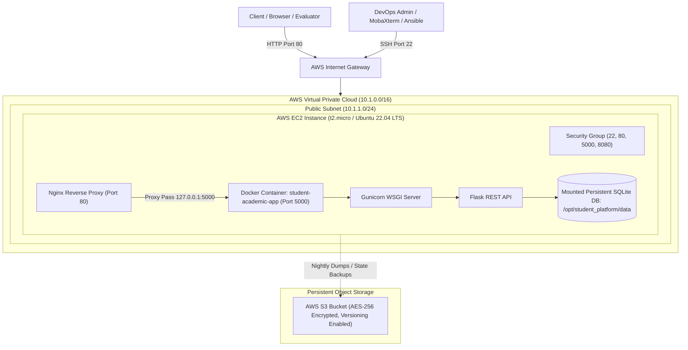

# Technical Architecture & Deployment Report
## Enterprise Student Record and Academic Management Platform
**Course Module:** Unit 4: DevOps & Cloud Infrastructure Automation  
**Platform Target:** Amazon Web Services (AWS)  
**IaC & Automation Engines:** HashiCorp Terraform (v1.7+) & Ansible Core (v2.16+)  
**WSGI Runtime & Proxy:** Gunicorn 22.0.0, Python Flask 3.0.3, Nginx Reverse Proxy, Docker Engine  

---

## 1. Executive Summary & Architecture Overview
This project codifies and automates the entire infrastructure and application lifecycle of the **Enterprise Student Record and Academic Management Platform** on Amazon Web Services (AWS). Manual configuration ("ClickOps") has been completely eliminated in favor of deterministic **Infrastructure as Code (Terraform)** and idempotent **Configuration Management (Ansible)**.

### Architecture Topology


---

## 2. Infrastructure Specification & Mapping (Unit 4 Adaptation)

| Infrastructure Primitive | Implementation Specification | Purpose / Function |
| :--- | :--- | :--- |
| **Virtual Private Cloud (VPC)** | `10.1.0.0/16` | Dedicated network boundary and packet routing isolation |
| **Public Subnet** | `10.1.1.0/24` in `us-east-1a` | Hosts EC2 instance with public IPv4 addressing enabled |
| **Internet Gateway (IGW)** | Attached to VPC, Route `0.0.0.0/0` | Direct bidirectional internet communication |
| **Security Group** | Ingress: 22 (SSH), 80 (HTTP), 5000 (App), 8080. Egress: all | Stateful firewall rules for administrative and web access |
| **Compute Instance** | `t2.micro` (1 vCPU, 1 GiB RAM), 20GB gp3 EBS | Ubuntu 22.04 LTS host runtime |
| **Persistent Storage** | SQLite mount `/opt/student_platform/data` | Thread-safe student and marks record storage |
| **Backup Storage** | AWS S3 Bucket (`AES-256`, Versioning Enabled) | Database snapshots, disaster recovery, and logs |

---

## 3. Four-Tier Post-Deployment Validation Gates

```
+-------------------------------------------------------------------------+
| GATE 1: Network & OS Reachability                                       |
| Command: nc -zv -w 5 <EC2_IP> 22 && ssh -i <key> ubuntu@<EC2_IP> uptime |
| Expected: Port 22 open, Ubuntu 22.04 kernel responsive.                 |
+-------------------------------------------------------------------------+
                                    |
                                    v
+-------------------------------------------------------------------------+
| GATE 2: Daemons & Port Binding                                          |
| Command: ansible -m systemd -a "name=docker state=started" academic_servers
| Expected: Docker daemon active; Nginx listening on Port 80.             |
+-------------------------------------------------------------------------+
                                    |
                                    v
+-------------------------------------------------------------------------+
| GATE 3: Container Lifecycle & Volume Persistence                        |
| Command: docker ps --filter name=student-academic-app                   |
| Expected: Container Up, port 5000 mapped, volume mounted.               |
+-------------------------------------------------------------------------+
                                    |
                                    v
+-------------------------------------------------------------------------+
| GATE 4: REST API Smoke Tests                                            |
| Command: python test_endpoints.py http://<EC2_IP>                       |
| Endpoints: GET /api/health, GET /api/students, POST /api/marks (UP)     |
+-------------------------------------------------------------------------+
```

---

## 4. API Endpoints Reference

| Endpoint | Method | Description | Sample Payload / Expected Response |
| :--- | :--- | :--- | :--- |
| `/api/health` | `GET` | Health status and DB check | `{"status":"UP","database":"UP","service":"student-academic-platform"}` |
| `/api/students` | `GET` | List all students | Returns array of student objects and total count |
| `/api/students` | `POST` | Register a new student | `{"student_id":"STU104","name":"Diana Prince","email":"diana@uni.edu","department":"SE","semester":2}` |
| `/api/students/<id>` | `GET` | Retrieve student & marks | Returns student profile and aggregated course marks |
| `/api/marks` | `GET` | List all mark records | Returns all recorded academic grades and student names |
| `/api/marks` | `POST` | Record student mark | `{"student_id":"STU104","course_code":"CS401","course_name":"Cloud & DevOps","score":95.0}` |

---

## 5. Idempotent Ansible Role Architecture
1. **`roles/common`**: Updates APT repositories, installs essential dependencies (`curl`, `git`, `jq`, `ufw`), and configures firewall rules.
2. **`roles/docker`**: GPG signature verification, official Docker CE repository configuration, and Docker daemon lifecycle management.
3. **`roles/nginx`**: High-performance reverse proxy setup with templated upstream forwarding to port 5000 and HTTP header buffering.
4. **`roles/student_app`**: Synchronizes source artifacts, builds container image, deploys container with restart policy `always`, mounts database volume, and executes healthcheck assertion.
